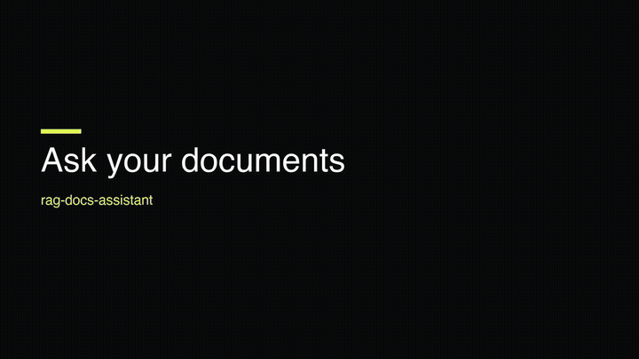
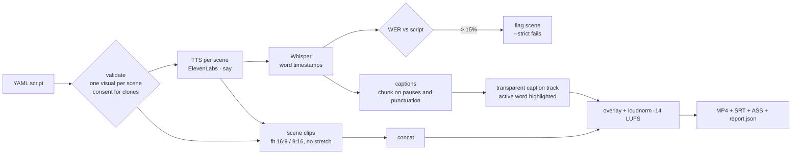

# voice-demo-generator

[](https://github.com/joaofrancowork/voice-demo-generator/actions/workflows/ci.yml)


Write a demo as a YAML script and get a narrated, captioned product video in **16:9 and 9:16**.
Text-to-speech (ElevenLabs, including cloned voices, or local voices), **Whisper word-level
alignment** for captions that stay in sync, an automatic **check that the narration actually
says the script**, and an ffmpeg pipeline that outputs platform-ready files.



*Rendered from [`examples/portfolio-demo.yaml`](examples/portfolio-demo.yaml) with a local macOS
voice. Whisper heard all four scenes exactly as written (WER 0%).*

## Quick start

```bash
git clone https://github.com/joaofrancowork/voice-demo-generator && cd voice-demo-generator
uv sync                                    # needs ffmpeg on PATH
uv run demo-gen render examples/portfolio-demo.yaml --aspect both --out out
```

For production voices, set `ELEVENLABS_API_KEY` and use `provider: elevenlabs` with a voice id.
Docker: `docker run --rm -v "$PWD:/work" -e ELEVENLABS_API_KEY voice-demo-generator render demo.yaml`.

## The script

```yaml
name: onboarding-demo
language: en
voice:
  provider: elevenlabs        # elevenlabs | say (macOS, offline) | tone (tests)
  voice: <voice_id>           # a library voice or an Instant Voice Clone
  cloned: true
  consent: true               # required for cloned voices, or the script is rejected
brand: { background: "#0b0b0b", foreground: "#ffffff", accent: "#d6ff3d" }
pronunciations:               # spoken form for names the voice would get wrong
  ENT-42: E N T forty-two
scenes:
  - title: Bookings on autopilot
    subtitle: Northwind
    narration: Meet Northwind. Your customers book in seconds, day or night.
  - video: clips/dashboard.mov  # screen recording: looped or trimmed to the narration
    narration: This is the dashboard your team opens every morning.
  - image: shots/phone.png      # stills get a slow push-in so the frame never freezes
    narration: And this is what your customer sees on their phone.
```

## Pipeline



## Design decisions

- **Captions from the audio, not from the text.** Whisper's word timestamps on the *generated*
  narration drive the captions, so they stay in sync whatever the voice's pace, pauses or
  language. Lines break on pauses, punctuation or five words, like social-video captions.
- **Verify the voice said the script.** TTS sometimes skips a clause, reads "ENT-42" as
  something else or mangles numbers. The same transcription is compared with the script (word
  error rate); scenes above 15% are flagged in the report, and `--strict` fails the render. In
  a batch of personalised demos, this catches the bad one before a customer sees it.
- **Consent is part of the schema.** A cloned voice cannot be used unless the script declares
  `consent: true`. It is a small guard, but it puts the policy in the artefact that gets
  reviewed.
- **No libass dependency.** Captions are rendered with Pillow into a transparent video track
  and overlaid, so the pipeline works with any ffmpeg build (Homebrew's default has no libass).
  `.srt` and `.ass` sidecars are still exported for editors and platforms.
- **Audio decoding through ffmpeg.** Whisper gets 16 kHz float32 PCM decoded by ffmpeg,
  avoiding version-sensitive decoders, with one audio stack for the whole pipeline.
- **Broadcast-style finish.** Visuals are fitted without stretching, and loudness is
  normalised to −14 LUFS (the common target for social and streaming).

## Outputs

| File | Contents |
|---|---|
| `<name>-landscape.mp4` / `<name>-vertical.mp4` | H.264/AAC, faststart, captions burned in |
| `.srt`, `.ass` | Caption sidecars (ASS with karaoke timing in the brand accent) |
| `.report.json` | Per-scene duration, what Whisper heard, and WER |

## Testing

`pytest` (98% coverage) renders real videos with ffmpeg in both aspect ratios and checks the
dimensions, durations and sidecars. TTS is replaced by a deterministic tone and Whisper by a
scripted transcriber, so the suite runs in seconds without models or API keys. One test proves
the script check flags a scene whose audio says something else. ElevenLabs is tested against
a mocked HTTP transport. CI also runs the full pipeline with real Whisper and uploads the
rendered videos.

## Roadmap

- [ ] Background music with automatic ducking under the narration
- [ ] Batch mode: one personalised demo per row of a CSV (name, company, screenshot)
- [x] Pronunciation dictionary per brand (product names, acronyms) applied before TTS
- [ ] Word-level re-synthesis of only the flagged scene

## License

MIT. The example uses screenshots from my other open-source projects.
